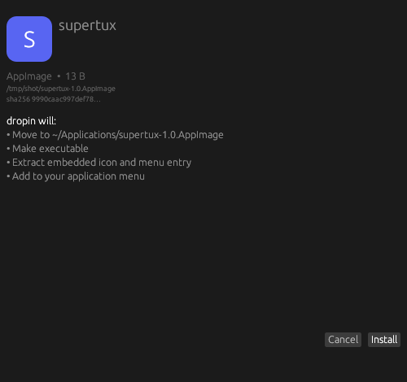

<p align="center">
  
</p>

<h1 align="center">dropin</h1>

<p align="center"><strong>Download it. Double-click it. Done.</strong></p>

<p align="center">
  <a href="https://github.com/nordicnode/dropin/actions/workflows/ci.yml"></a>
  
  
  
  
</p>

<p align="center">
  The universal Linux installer for all the weird files the internet hands you.<br>
  AppImages, <code>.deb</code>s, <code>.rpm</code>s, tarballs, Flatpaks, installer scripts —
  <strong>one double-click</strong>, no terminal, no root, and everything tracked<br>
  so uninstalls are actually clean.
</p>

---

## The ritual we're killing

You download `coolapp-2.4-linux-x86_64.tar.gz` and then…

```text
$ tar -tzf coolapp-2.4-linux-x86_64.tar.gz | head      # what's in here?
$ mkdir -p ~/.local/opt && tar -xzf ... -C ~/.local/opt
$ ln -s ~/.local/opt/coolapp-2.4/bin/coolapp ~/.local/bin/
$ # now hand-write a .desktop file for the menu, find an icon, hope you
$ # remember all of this when you want it gone
```

**With dropin:** you double-click the file. A dialog shows you exactly what it will do. You click Install. It's in your menu. `dropin remove coolapp` undoes every bit of it later.

## See it

<p align="center">
  
</p>

## What it handles

| You downloaded | dropin does — all in user scope, no root |
|---|---|
| `.AppImage` | Moves to `~/Applications`, makes executable, extracts the real icon + menu entry |
| `.deb` | Extracts the payload to `~/.local/opt/<pkg>` (pure Rust, no `dpkg` needed), adopts bundled `.desktop` files with paths rewritten, links `usr/bin/*` → `~/.local/bin` |
| `.rpm` | Same treatment via a pure-Rust RPM/cpio reader — no `rpm2cpio`, works on Debian too |
| `.tar.gz` / `.tar.xz` / `.zip` | Sniffs **app vs. data** by content: real apps get installed with menu entry + bin links; a folder of vacation photos gets refused with an explanation instead of a broken "install" |
| `.flatpakref` / `.flatpak` | `flatpak install --user` |
| `.sh` / `.run` / `.bin` | Shows you it's an executable script and **requires explicit confirmation** before running the vendor installer |
| `.exe` | Hands off to Wine if you have it, tells you plainly if you don't |

Detection is by **magic bytes, not file extensions** — rename a `.deb` to `.txt` and dropin still knows what it is.

## The ledger: installs you can actually undo

Every path dropin creates — files, symlinks, menu entries, icons — is recorded in a local SQLite database (`~/.local/share/dropin/ledger.db`). `dropin remove` walks it in reverse and deletes exactly what was installed. Nothing orphaned, nothing guessed.

```text
$ dropin install coolapp-2.4-linux-x86_64.tar.gz
Installed 'coolapp'.
Remove anytime with: dropin remove coolapp

$ dropin list
coolapp — tarball

$ dropin update --all        # on demand only. never in the background.
[manual]     coolapp    tarballs have no update channel — re-download upstream
[up-to-date] firefox     already current
```

Update channels are captured at install time (AppImage zsync info, Flatpak remotes); `dropin update` acts on what it can and is honest about the rest.

## Install

```sh
cargo install --git https://github.com/nordicnode/dropin dropin-cli
cargo install --git https://github.com/nordicnode/dropin dropin-gui   # the double-click dialog
dropin integrate   # right-click "Install as application" in Dolphin, Nemo, Nautilus & Thunar
```

Then just double-click any installer file.

## Usage

```text
dropin info <file>        # dry run: exactly what it would do, no changes
dropin install <file>     # install (shows the plan; scripts need confirmation)
dropin install --yes <file> --keep-source
dropin install --system <file.deb>   # real system install via apt/dnf/pacman (polkit)
dropin list               # everything dropin installed
dropin remove <name>      # clean removal, reversed from the ledger
dropin update [name|--all]  # check for updates, on demand only
dropin doctor             # verify helper tools
dropin integrate          # double-click + file-manager integration
dropin unintegrate        # remove all desktop integration
```

`dropin-gui <file>` is the graphical dialog — this is also what opens when you double-click a file after `dropin integrate`.

## Why not…

| | dropin | AppImageLauncher | exeify | your package manager |
|---|---|---|---|---|
| AppImage / deb / rpm / tarball / flatpak / scripts | ✅ all of them | AppImages only | most formats | repo packages only |
| Clean uninstall of sideloaded apps | ✅ ledger-tracked | ❌ | ❌ | n/a |
| No root required | ✅ | ⚠️ needs setup | ✅ | ❌ |
| Cross-desktop / cross-distro | ✅ | mostly Ubuntu-y | KDE + Arch only | — |
| Fully offline, no accounts, no telemetry | ✅ | ✅ | ✅ | ✅ |

The closest prior art is [exeify](https://github.com/scdouglas1999/exeify) — a handy script, but tied to KDE/Arch with no uninstall tracking. dropin's whole point is **the ledger**: install anything, remove everything.

## Principles

- **User scope by default.** Your home directory is yours; dropin never needs root unless you explicitly ask for a system install.
- **Show before doing.** `dropin info` and the GUI dialog always present the plan first. Installer scripts need your explicit say-so.
- **Fully offline.** No AI, no APIs, no accounts, no telemetry, no network calls — except the package managers you already have, when you ask.
- **Honest about limits.** If dropin can't update something automatically, it says so instead of pretending.

## Contributing

Issues and PRs welcome. `cargo test` and `cargo clippy --all-targets` must be clean — CI enforces it.

## License

MIT — see [LICENSE](LICENSE).
