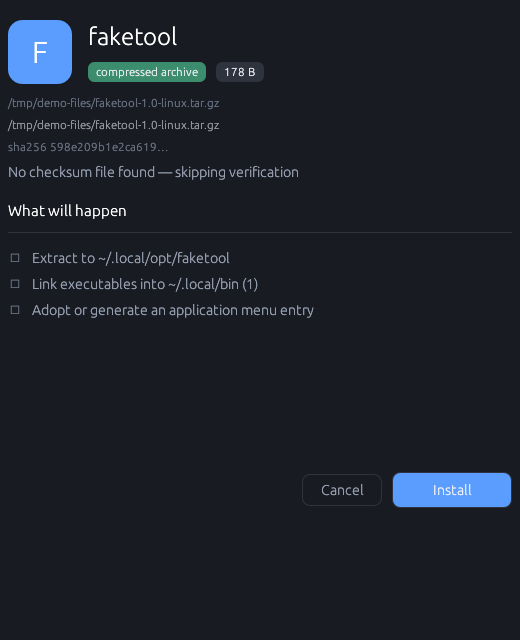
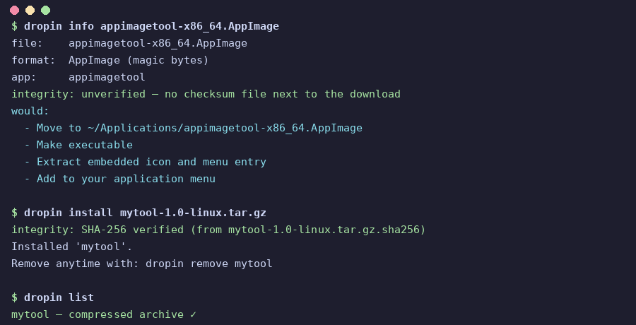
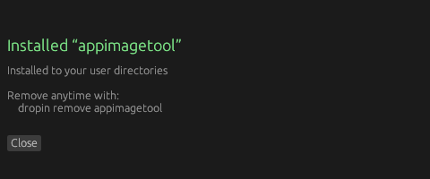

<p align="center">
  
</p>

<h1 align="center">dropin</h1>

<p align="center"><strong>Download it. Double-click it. Done.</strong></p>

<p align="center">
  <a href="https://github.com/nordicnode/dropin/actions/workflows/ci.yml"></a>
  
  
  
  
</p>

<p align="center">
  The universal Linux installer for all the weird files the internet hands you.<br>
  AppImages, <code>.deb</code>s, <code>.rpm</code>s, tarballs, Flatpaks, installer scripts.
  One double-click, no terminal, no root, and everything tracked<br>
  so uninstalls are actually clean.
</p>

---

## The ritual we're killing

You download `coolapp-2.4-linux-x86_64.tar.gz` and then…

```text
$ tar -tzf coolapp-2.4-linux-x86_64.tar.gz | head      # what's in here?
$ mkdir -p ~/.local/opt && tar -xzf ... -C ~/.local/opt
$ ln -s ~/.local/opt/coolapp-2.4/bin/coolapp ~/.local/bin/
$ # now hand-write a .desktop file for the menu, find an icon, hope you
$ # remember all of this when you want it gone
```

With dropin you just double-click the file. A dialog shows you exactly what it's about to do. You click Install. It's in your menu. Months later, when you're done with it, the manager removes every trace.

## See it in action

Double-click a real AppImage and dropin shows its whole plan up front, integrity check included:

<p align="center">
  
</p>

Prefer the terminal? Same deal. Dry-run, verified install, and the ledger keeping score:

<p align="center">
  
</p>

One click later it's in your menu, and removing it later is just as easy:

<p align="center">
  
</p>

## What it handles

| You downloaded | What dropin does (all in user scope, no root) |
|---|---|
| `.AppImage` | Moves to `~/Applications`, makes it executable, pulls out the real icon and menu entry |
| `.deb` | Extracts the payload to `~/.local/opt/<pkg>` with a pure-Rust reader (no `dpkg` needed), adopts the bundled `.desktop` files with paths fixed up, links `usr/bin/*` into `~/.local/bin` |
| `.rpm` | Same treatment through a pure-Rust RPM/cpio reader. Works on Debian too, no `rpm2cpio` required |
| `.tar.gz` / `.tar.xz` / `.zip` | Actually looks at what's inside. Real app? It gets installed with a menu entry and bin links. Folder of vacation photos? Refused with an explanation instead of a broken "install" |
| `.flatpakref` / `.flatpak` | Hands it to `flatpak install --user` |
| `.sh` / `.run` / `.bin` | Tells you it's an executable vendor script and won't run it until you explicitly say so |
| `.exe` | Passes it to Wine if you've got it, tells you straight if you don't |

Detection goes by magic bytes, not file extensions. Rename a `.deb` to `.txt` and dropin still knows what it's looking at.

## The ledger: installs you can actually undo

Everything dropin creates, files, symlinks, menu entries, icons, gets written to a little SQLite database at `~/.local/share/dropin/ledger.db`. Removing an app just walks that list backwards and deletes exactly what was installed. Nothing orphaned, nothing guessed at. If the database itself gets corrupted, dropin backs it up and starts fresh instead of refusing to run.

```text
$ dropin install coolapp-2.4-linux-x86_64.tar.gz
Installed 'coolapp'.
Remove anytime with: dropin remove coolapp

$ dropin list
coolapp — tarball

$ dropin update --all
[manual]     coolapp    tarballs have no update channel, re-download upstream
[up-to-date] firefox    already current
```

## AppImage generations: updates without fear

AppImages live in `~/Applications/<app>/<version>/`, with an `active` symlink pointing at the current one. Menu entries point at `active`, so switching versions is instant and never touches your launchers.

Update channels get captured at install time (AppImage zsync info, Flatpak remotes). `dropin update` does what it can and tells you plainly about the rest. AppImages update over a native zsync delta, so only the changed blocks come down the wire. The result gets SHA-1 verified, and the new version lands in its own directory, which means `dropin rollback <name>` flips `active` back to the previous version instantly. Only the last two generations are kept; older ones are pruned automatically.

For AppImages from GitHub releases with no zsync channel, `dropin track <name> --github owner/repo` follows the repo instead. If the release ships a detached signature (`.asc`/`.sig`), dropin pins the signing key on first install and refuses updates signed by a different key. Update checks use ETag caching so a quiet week costs you zero API quota.

## Installer scripts: audited, sandboxed, reversible

`.sh`, `.run`, and `.bin` files are vendor scripts that can do anything, so dropin treats them with care:

- **Static audit first.** Before anything runs, dropin scans the script and explains what it found in plain language: what it will install, whether it wants the internet, whether it touches system folders or asks for sudo. No jargon.
- **Sandboxed execution.** Scripts run under bubblewrap: no network unless you allow it, the system read-only, only your install folders writable, your SSH and GPG keys hidden. If bubblewrap isn't installed, dropin refuses rather than running unsandboxed.
- **Full logging.** Every byte of installer output is logged to `~/.local/share/dropin/script-logs/`, viewable from the GUI.
- **Complete undo.** Before the script runs, dropin snapshots your writable folders and backs up every file. Removing the app later deletes what the installer added and restores what it changed or deleted, with a plain-language summary of what was undone.

The GUI shows the audit findings, lets you allow internet for that install only, and offers one-click retry with internet if a blocked download was the failure.

## Install

```sh
cargo install --git https://github.com/nordicnode/dropin dropin-cli
cargo install --git https://github.com/nordicnode/dropin dropin-gui   # the double-click dialog
dropin integrate   # adds "Install as application" to Dolphin, Nemo, Nautilus & Thunar
```

Then just double-click any installer file.

## Usage

The GUI is the whole app. Open **dropin** from your app menu (or run `dropin-gui`) and you get the manager: your installed apps, updates, rollback, removal, GitHub release tracking, and doctor. No terminal needed. Double-clicking an installer file opens the install dialog directly. `dropin integrate` sets all of that up, plus the file manager entries.

There's also a CLI that does the same things, handy for scripting:

```text
dropin list               # everything dropin installed (✓ = checksum-verified)
dropin launch <name>      # run an installed app
dropin update [name|--all]  # check for updates, on demand only
dropin rollback <name>    # restore an AppImage to its previous version
dropin track <name> --github owner/repo    # follow a GitHub repo's releases
dropin untrack <name>     # stop following
dropin remove <name>      # clean removal, reversed from the ledger
dropin remove --purge <name>  # also move leftover config/cache/data to the trash
dropin doctor             # health checks: broken menus, orphans, missing tools
dropin info <file>        # dry run showing exactly what would happen, no changes
dropin install <file>     # install (shows the plan first; scripts need confirmation)
dropin install --allow-net <file>  # let a sandboxed script use the internet
dropin set-env <name> <key> <value>    # set an env var used when launching
dropin unset-env <name> <key>          # remove an env var
dropin export <file>      # back up the app list to JSON
dropin import <file>      # review an exported app list
dropin integrate          # double-click plus file-manager plus menu integration
dropin unintegrate        # remove all desktop integration
```

The manager GUI (`dropin-gui`, or just **dropin** in your app menu) does all of this visually: drag-and-drop install, per-app launch/update/rollback/remove, environment variables, GitHub tracking, doctor, and settings. Search to filter the list, select multiple apps for bulk update/remove, and export your app list for backup. It can also check for updates automatically when it opens (opt-in, in settings).

## Why not…

| | dropin | AppImageLauncher | exeify | your package manager |
|---|---|---|---|---|
| AppImage / deb / rpm / tarball / flatpak / scripts | ✅ all of them | AppImages only | most formats | repo packages only |
| Clean uninstall of sideloaded apps | ✅ ledger-tracked | ❌ | ❌ | n/a |
| No root required | ✅ | ⚠️ needs setup | ✅ | ❌ |
| Cross-desktop / cross-distro | ✅ | mostly Ubuntu-y | KDE + Arch only | — |
| Fully offline, no accounts, no telemetry | ✅ | ✅ | ✅ | ✅ |

The closest thing out there is [exeify](https://github.com/scdouglas1999/exeify). It's a handy script, but it's tied to KDE on Arch and doesn't track what it installs. That's really the whole point of dropin: the ledger. Install anything, remove everything.

## Principles

- **Your home directory is yours.** Dropin installs to user scope and never asks for root unless you explicitly choose a system install.
- **Show before doing.** The GUI dialog and `dropin info` always lay out the plan first. Installer scripts need your explicit okay.
- **Fully offline core.** No AI, no accounts, no telemetry, no phoning home. The only network use is what you explicitly approve: GitHub release checks for apps you choose to track (only when you open the manager, ETag-cached, toggleable), and one-time internet access for a sandboxed installer when you allow it.
- **Rootless by default.** Scripts run sandboxed without admin rights; system installs are opt-in.
- **Honest about limits.** If dropin can't update something automatically, it says so instead of pretending.

## Contributing

Issues and PRs welcome. `cargo test` and `cargo clippy --all-targets` need to be clean, CI checks.

## License

MIT, see [LICENSE](LICENSE).
